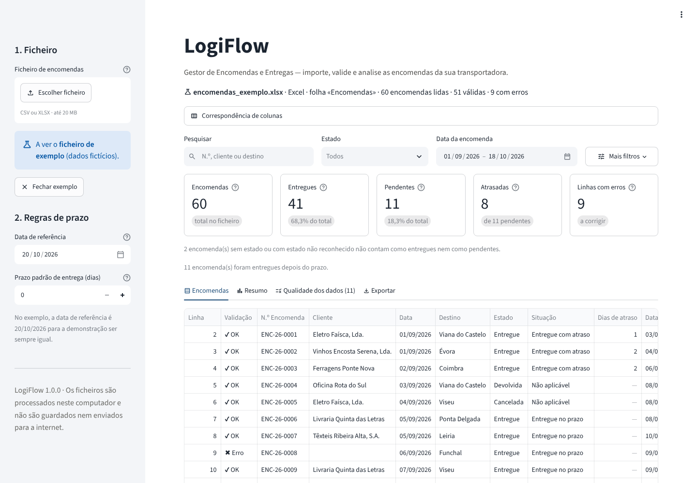

# LogiFlow — Gestor de Encomendas e Entregas

Aplicação para pequenas transportadoras e empresas de distribuição: importa a lista de
encomendas (Excel ou CSV), verifica a qualidade dos dados, mostra indicadores e exporta
dados limpos e um relatório em Excel. Funciona no seu computador, sem internet e sem
guardar nada.



## O que faz

| Funcionalidade | Onde está |
| --- | --- |
| Importar ficheiros **Excel (.xlsx)** e **CSV** (separados por `;` ou `,`) | Barra lateral → «1. Ficheiro» |
| Validar as colunas obrigatórias: n.º de encomenda, cliente, data, destino e estado | Automático; pode corrigir em «Correspondência de colunas» |
| Tabela com pesquisa e filtros por estado, data, situação face ao prazo e validação | Separador «Encomendas» |
| Detetar campos vazios, números de encomenda duplicados e datas inválidas | Separador «Qualidade dos dados» |
| Indicadores: total, entregues, pendentes e atrasadas | Topo da página |
| Exportar dados limpos e relatório em Excel | Separador «Exportar» |
| Ficheiro de exemplo com dados fictícios | Botão «Experimentar com o ficheiro de exemplo» |

---

## Instalação no Windows (passo a passo)

Só é preciso fazer isto uma vez.

### 1. Instalar o Python

1. Abra <https://www.python.org/downloads/> e descarregue o **Python 3.13** (ou mais recente; o
   mínimo é o 3.11).
2. Execute o instalador. **No primeiro ecrã, marque a caixa «Add python.exe to PATH»** e carregue
   em «Install Now».

> Em alternativa, numa janela do PowerShell: `winget install -e --id Python.Python.3.13`

### 2. Obter o projeto

Descarregue o repositório do GitHub (botão verde **Code → Download ZIP**) e extraia-o, por
exemplo, para `C:\LogiFlow`. A aplicação está dentro da pasta **`logiflow`**.

### 3. Instalar a aplicação

Abra a pasta `logiflow` e faça **duplo clique em `instalar.bat`**. O script:

- confirma que o Python está instalado e é a versão 3.11 ou superior;
- cria uma pasta `.venv` (um «ambiente virtual»: uma instalação de Python só para esta
  aplicação, que não mexe no resto do computador);
- instala as bibliotecas indicadas em `requirements.txt` (demora 1 a 3 minutos na primeira vez).

> Se o Windows mostrar «O Windows protegeu o seu PC», clique em **Mais informações → Executar
> mesmo assim**. Acontece com qualquer script descarregado da internet.

### 4. Abrir a aplicação

Faça **duplo clique em `iniciar.bat`**. Abre-se uma janela preta (deixe-a aberta) e o navegador
mostra a aplicação (normalmente em <http://localhost:8501>). Para fechar, feche essa janela preta.

### Alternativa: comandos no PowerShell

Se preferir a linha de comandos (clique com o botão direito na pasta `logiflow` → «Abrir no
Terminal»):

```powershell
# 1. Criar o ambiente virtual (só na primeira vez)
py -3 -m venv .venv

# 2. Instalar as dependências (só na primeira vez)
.venv\Scripts\python.exe -m pip install -r requirements.txt

# 3. Iniciar a aplicação (sempre que a quiser usar)
.venv\Scripts\python.exe -m streamlit run app.py
```

Estes comandos usam diretamente o `python.exe` da pasta `.venv`, por isso não é preciso
«ativar» o ambiente virtual (o que no PowerShell costuma dar erros de permissões).

---

## Como usar

1. **Importe um ficheiro** na barra lateral, ou clique em «Experimentar com o ficheiro de exemplo».
2. **Confirme as colunas.** A aplicação reconhece cabeçalhos comuns («Nº Encomenda», «Localidade»,
   «Situação»...). Se faltar alguma coluna obrigatória, aparece uma mensagem a dizer qual, e pode
   escolher a coluna certa em «Correspondência de colunas».
3. **Reveja os indicadores e a tabela.** Os filtros afetam a tabela, os indicadores e os gráficos.
4. **Veja a «Qualidade dos dados»**: cada problema indica a linha do ficheiro original, para o
   poder corrigir na origem.
5. **Exporte** os dados limpos e o relatório (separador «Exportar»).

### Formato do ficheiro

| Coluna | Obrigatória | Exemplos de cabeçalho aceites |
| --- | --- | --- |
| N.º Encomenda | Sim | Nº Encomenda, Número da Encomenda, Encomenda, Order ID |
| Cliente | Sim | Nome do Cliente, Customer |
| Data | Sim | Data da Encomenda, Data do Pedido, Order Date |
| Destino | Sim | Localidade, Cidade, Local de Entrega |
| Estado | Sim | Situação, Estado da Encomenda, Status |
| Data Prevista | Não | Prazo de Entrega, Data Limite, Due Date |
| Data de Entrega | Não | Data da Entrega, Data Efetiva de Entrega, Entregue em |

- Maiúsculas, acentos e pontuação nos cabeçalhos são ignorados.
- Outras colunas (peso, observações...) são mantidas e aparecem nas exportações.
- Se o Excel tiver um título nas primeiras linhas, o cabeçalho é encontrado automaticamente.
- **Datas:** `dd/mm/aaaa` (também `dd-mm-aaaa`, `dd.mm.aa` e `aaaa-mm-dd`) ou células de data do
  Excel. `03/04/2026` é sempre 3 de abril.
- **CSV:** separado por `;` ou `,`; codificação UTF-8 ou Windows-1252 (a do Excel em português).

### Regras de cálculo

| Indicador | Regra |
| --- | --- |
| **Entregues** | Só as encomendas cujo estado diz «Entregue». Ter uma data de entrega **não** basta: gera um aviso, mas a encomenda não é contada como entregue. |
| **Pendentes** | Estados «Pendente» e «Em trânsito». |
| **Atrasadas** | Pendentes cujo prazo já passou na **data de referência** (normalmente hoje). O prazo é a «Data Prevista»; se não existir, pode definir um **prazo padrão** em dias na barra lateral. Sem nenhum dos dois, o indicador mostra «—» (não disponível) em vez de inventar um valor. Uma encomenda que vence hoje ainda está no prazo. |

Estados reconhecidos (em qualquer combinação de maiúsculas e acentos):

| Estado | Também aceite como |
| --- | --- |
| Pendente | por expedir, a aguardar expedição, em preparação, pending |
| Em trânsito | em distribuição, expedida, enviada, em rota, saiu para entrega, shipped |
| Entregue | entrega efetuada, entrega concluída, delivered |
| Cancelada | anulada, cancelled |
| Devolvida | devolução, returned |

Um estado que não esteja nesta lista (por exemplo, «Concluída») **não é adivinhado**: a linha
recebe um aviso e não conta como entregue nem como pendente.

### Erros e avisos

| Tipo | Gravidade | O que acontece à linha |
| --- | --- | --- |
| Campo obrigatório vazio | Erro | Vai para a folha «Linhas com erros» |
| N.º de encomenda duplicado (todas as ocorrências) | Erro | Vai para «Linhas com erros» — a aplicação não escolhe qual é a certa |
| Data inválida (`31/02/2026`, texto, ano fora de 2000–2100) | Erro | Vai para «Linhas com erros» |
| Estado não reconhecido | Aviso | Mantém-se nos dados limpos, com o aviso |
| Datas incoerentes (entrega antes da encomenda, data no futuro...) | Aviso | Mantém-se nos dados limpos, com o aviso |

**Nenhuma linha se perde:** o ficheiro de dados limpos tem as linhas válidas numa folha e as
linhas com erros noutra, com os valores originais e o motivo. A folha «Informação» confirma que
válidas + com erros = total lido. Linhas totalmente vazias são ignoradas, mas a aplicação diz
quantas eram.

### O que é exportado

- **Dados limpos (.xlsx):** «Encomendas válidas» (datas como datas do Excel, espaços retirados,
  estados uniformizados), «Linhas com erros» (valores originais + motivo) e «Informação».
- **Relatório (.xlsx):** «Resumo» (indicadores, regra de prazo usada, qualidade dos dados),
  «Por estado», «Atrasadas», «Problemas» e «Todas as encomendas».

As exportações incluem sempre todas as encomendas do ficheiro, independentemente dos filtros.

---

## Segurança e privacidade

- **Tudo local.** A aplicação só aceita ligações do próprio computador (`localhost`). Não há base
  de dados nem ficheiros guardados: ao fechar, os dados desaparecem. A recolha de estatísticas do
  Streamlit está desligada. Depois da instalação, não precisa de internet.
- **Sem credenciais nem serviços pagos.**
- **Os ficheiros são tratados como dados, nunca como código.** As fórmulas do Excel não são
  calculadas e as macros nunca são executadas. O pacote `defusedxml` protege contra ficheiros
  Excel com XML malicioso, e os ficheiros comprimidos de forma anómala («bombas ZIP») são recusados.
- **Limites claros:** 20 MB por ficheiro, 200 000 linhas e 200 colunas, com mensagens a explicar.
- **Proteção contra injeção de fórmulas:** um valor como `=HYPERLINK(...)` vindo do ficheiro é
  gravado nas exportações como texto, nunca como fórmula. Por isso, o botão de exportação CSV
  incorporado nas tabelas está desligado e as exportações fazem-se pelos botões de Excel.
- **CSV mal formado** (por exemplo, aspas por fechar) é recusado com indicação da linha, em vez
  de juntar silenciosamente várias linhas num só campo.

### Dependências e porque são precisas

| Pacote | Para quê |
| --- | --- |
| `streamlit` | A interface no navegador |
| `pandas` | A tabela de encomendas, pesquisa e filtros |
| `openpyxl` | Ler e escrever ficheiros Excel |
| `defusedxml` | Segurança na leitura de Excel (o openpyxl usa-o automaticamente) |
| `pytest` | Só para os testes (`requirements-dev.txt`) |

---

## Ficheiro de exemplo

`dados_exemplo/encomendas_exemplo.xlsx` e `.csv` têm 60 encomendas **inteiramente fictícias**:
os nomes de empresas foram inventados (qualquer semelhança com empresas reais é coincidência) e
não há pessoas, moradas, contribuintes nem contactos. Os destinos são nomes de localidades.

Inclui problemas colocados de propósito, para a demonstração:

| Linha | Problema |
| --- | --- |
| 9 | Cliente vazio |
| 17 | Destino vazio |
| 23 e 24 | N.º de encomenda repetido, com dados diferentes |
| 32 | Data `31/02/2026` (não existe) |
| 40 | Data prevista «brevemente» |
| 49 | Estado «A confirmar» (aviso) |
| 51 | Tem data de entrega, mas o estado é «Em trânsito» (aviso) |
| 52 | Estado vazio |
| 60 e 61 | Linha repetida por inteiro |

Com a data de referência 20/10/2026 (usada automaticamente quando abre o exemplo), os indicadores
são: 60 encomendas, 41 entregues, 11 pendentes, 8 atrasadas e 9 linhas com erros.

Para voltar a gerar os ficheiros: `.venv\Scripts\python.exe scripts\gerar_exemplo.py`

---

## Testes automáticos

Faça duplo clique em **`testar.bat`**, ou:

```powershell
.venv\Scripts\python.exe -m pip install -r requirements-dev.txt
.venv\Scripts\python.exe -m pytest
```

São 100 testes, que verificam:

- **Importação:** codificações, separadores, cabeçalho depois de um título, linhas vazias, colunas
  sem nome, ficheiros inválidos, demasiado grandes ou maliciosos, e fórmulas que não são executadas.
- **Validação:** deteção de colunas, campos vazios, duplicados, datas válidas e inválidas, estados,
  e que nenhuma encomenda é dada como entregue sem o estado o dizer.
- **Indicadores:** atrasos com data prevista, com prazo padrão e sem dados.
- **Exportações:** nenhuma linha se perde, as datas ficam datas, nada é gravado como fórmula e o
  relatório bate certo com os indicadores.
- **Interface:** a aplicação abre, carrega o exemplo, os filtros atualizam os indicadores e as
  exportações ficam disponíveis.

---

## Estrutura do projeto

```
logiflow/
├── app.py                  ← interface (ecrãs, filtros, botões)
├── logiflow/               ← lógica da aplicação, testável sem interface
│   ├── campos.py           ← colunas aceites, estados e deteção automática
│   ├── importacao.py       ← leitura segura de CSV e Excel
│   ├── datas.py            ← interpretação de datas (dia/mês/ano)
│   ├── validacao.py        ← vazios, duplicados, datas inválidas, avisos
│   ├── indicadores.py      ← prazos, atrasos e indicadores
│   ├── exportacao.py       ← Excel de dados limpos e relatório
│   └── exemplo.py          ← localização do ficheiro de exemplo
├── tests/                  ← testes automáticos (pytest)
├── dados_exemplo/          ← ficheiros de exemplo (dados fictícios)
├── scripts/gerar_exemplo.py← gera os ficheiros de exemplo
├── docs/                   ← capturas de ecrã
├── .streamlit/config.toml  ← configuração (só localhost, sem estatísticas, tema)
├── instalar.bat / iniciar.bat / testar.bat  ← atalhos para Windows
├── requirements.txt        ← dependências da aplicação
└── requirements-dev.txt    ← dependências dos testes
```

Porque está separado assim: o `app.py` só desenha o ecrã e chama as funções da pasta `logiflow/`.
Toda a regra de negócio (o que é um erro, o que é um atraso) está num só sítio e é testada
automaticamente, sem abrir o navegador.

---

## Funcionalidades não implementadas e limitações

Estas funcionalidades **não estão implementadas** nesta versão:

- **Ficheiros `.xls` (Excel 97-2003)** e ficheiros Excel protegidos por palavra-passe — guarde
  como `.xlsx`.
- **Guardar dados entre sessões, histórico ou base de dados** — decisão deliberada: não era
  necessário para importar, validar e exportar, e assim nenhum dado de cliente fica no disco.
- **Editar encomendas dentro da aplicação** — corrija o ficheiro de origem e importe-o de novo.
- **Importar vários ficheiros de uma vez** ou juntar ficheiros.
- **Exportar só as encomendas filtradas**, ou exportar em CSV ou PDF (exporta-se sempre o
  ficheiro completo, em Excel).
- **Utilizadores, palavras-passe ou acesso por várias pessoas na rede.**
- **Integrações** com transportadoras, GPS, mapas, rotas, faturação, e-mail ou SMS.
- **Datas guardadas como número** (por exemplo, `45930`) não são convertidas, porque não é
  possível ter a certeza de que são datas: aparecem como data inválida.
- **Fórmulas do Excel sem valor guardado** (ficheiros gerados por outros programas) aparecem
  vazias: a aplicação nunca calcula fórmulas.

Outras limitações:

- Ficheiros com mais de 5 000 encomendas: os Excel são preparados a pedido (botão «Preparar
  ficheiros Excel»). Com 100 000 encomendas, pode demorar perto de um minuto.
- Alguns textos internos do Streamlit aparecem em inglês (menu de ordenação das colunas e nomes
  dos meses no calendário).
- A interface foi pensada para ecrãs de computador (a partir de 1366 × 768); não está otimizada
  para telemóvel.

---

## Resolução de problemas

| Problema | Solução |
| --- | --- |
| «O Python não foi encontrado» ou abre a Microsoft Store | Instale o Python de python.org e marque «Add python.exe to PATH». Feche e volte a abrir a janela. |
| O navegador não abre | Abra manualmente o endereço que aparece na janela preta, em «Local URL» (normalmente <http://localhost:8501>). |
| Abriu-se em <http://localhost:8502> | Já havia outro LogiFlow aberto. Pode fechar a janela preta mais antiga. |
| Acentos trocados num CSV | No Excel, guarde com «CSV UTF-8 (delimitado por vírgulas)». |
| «Faltam colunas obrigatórias» | Abra «Correspondência de colunas» e escolha a coluna certa para cada campo. |
| O antivírus bloqueia o `.bat` | Os scripts só criam a pasta `.venv` e iniciam a aplicação; pode abri-los no Bloco de Notas para confirmar. Em alternativa, use os comandos do PowerShell acima. |

## Demonstração a clientes

Ver [DEMONSTRACAO.md](DEMONSTRACAO.md): guião de 10 minutos com o ficheiro de exemplo.
